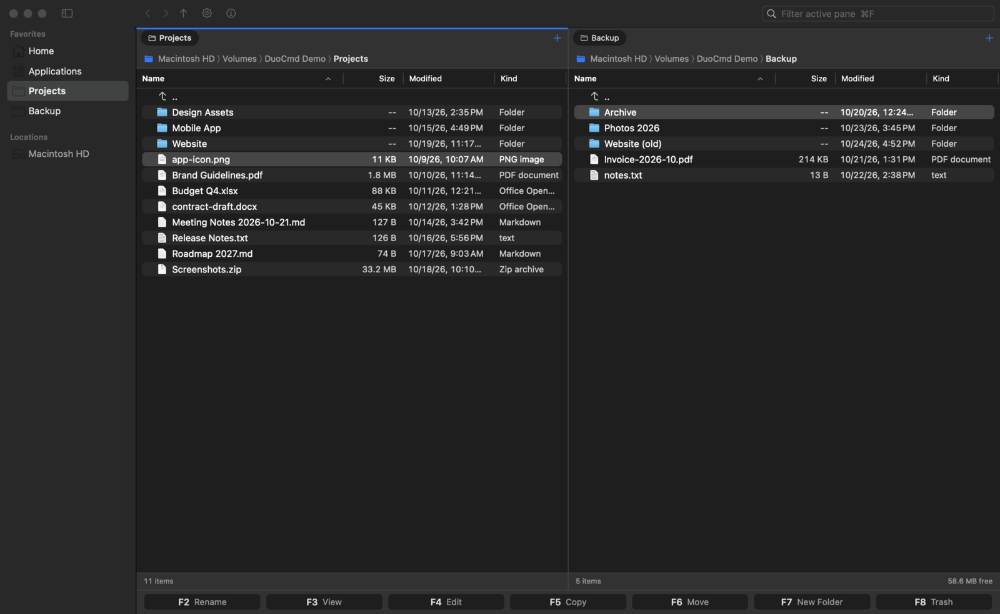
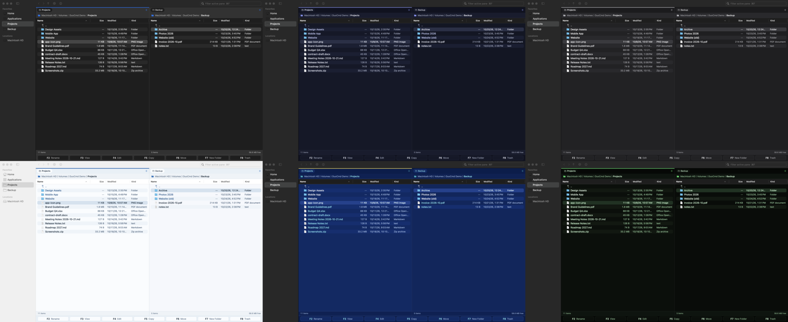
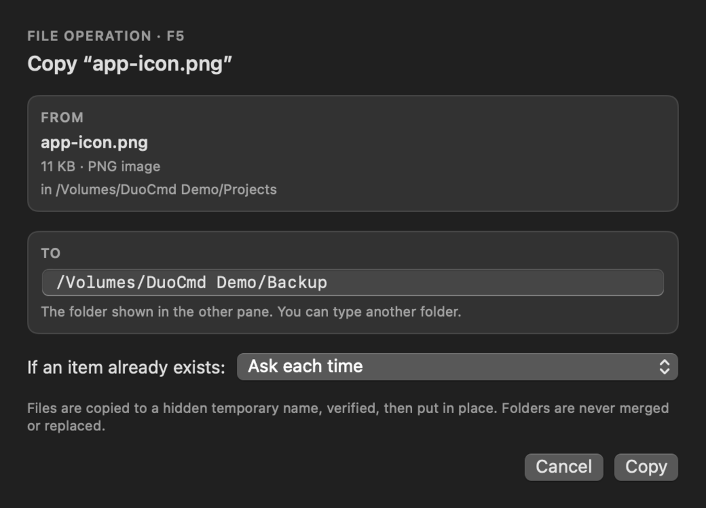
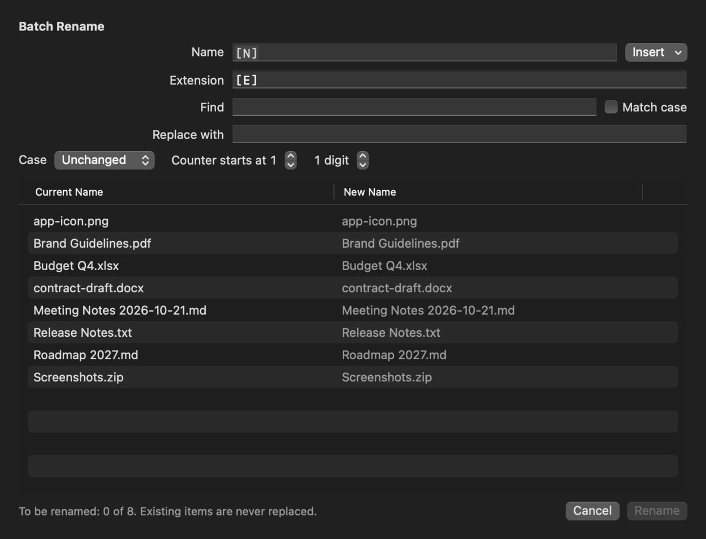
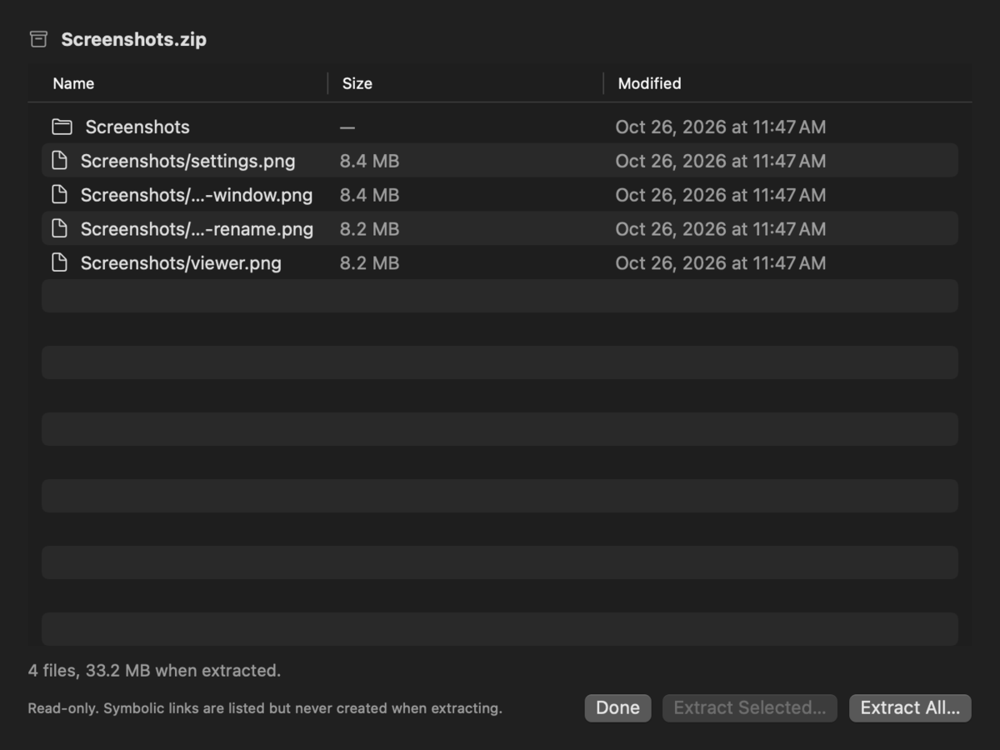
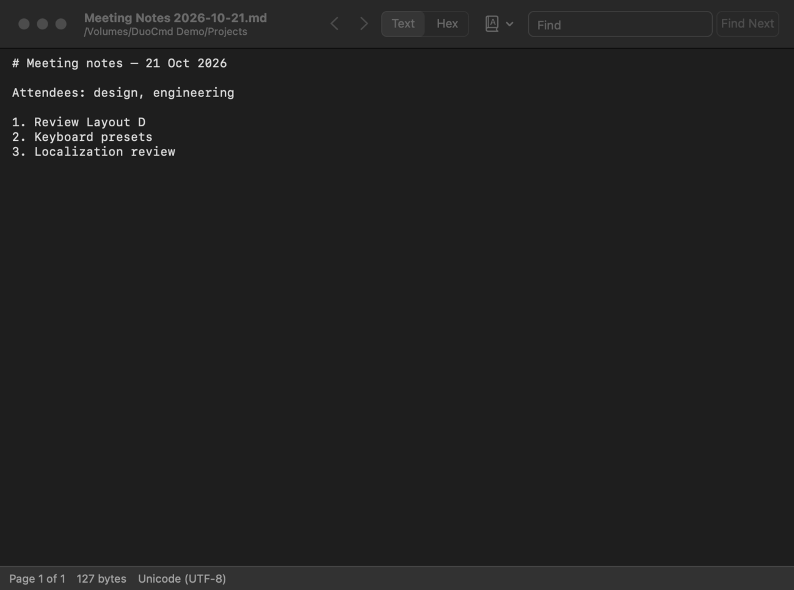
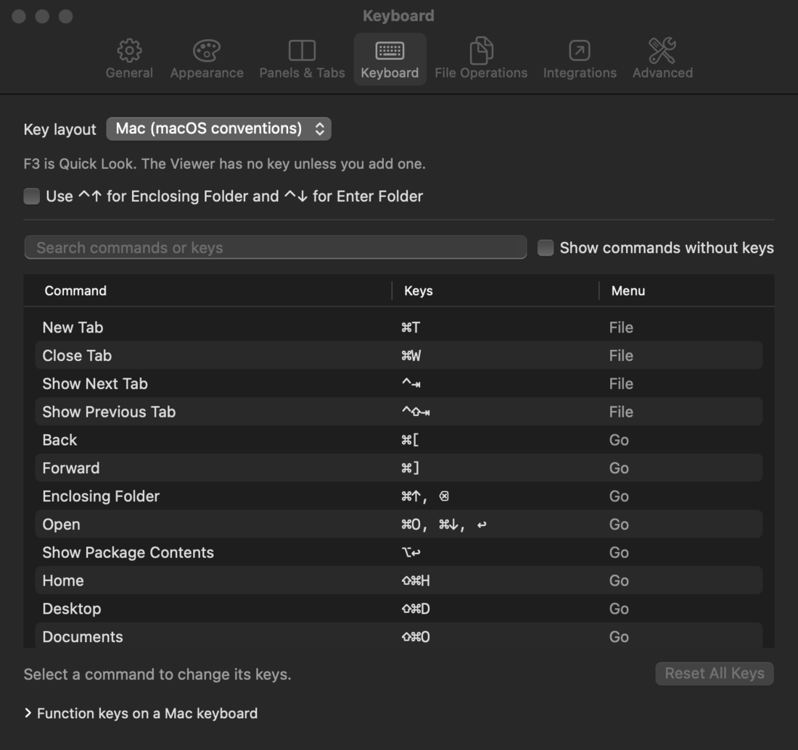
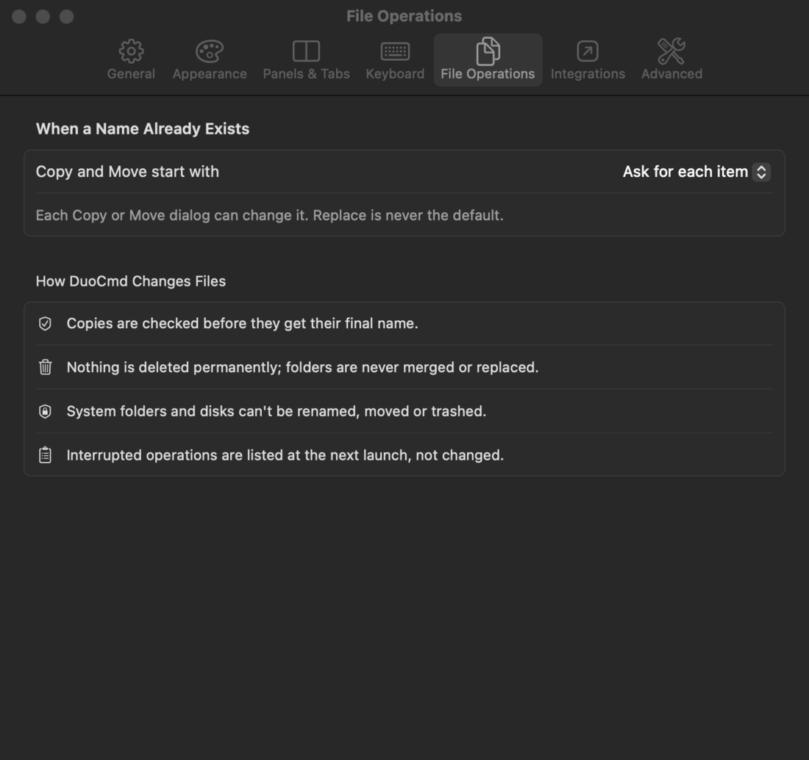
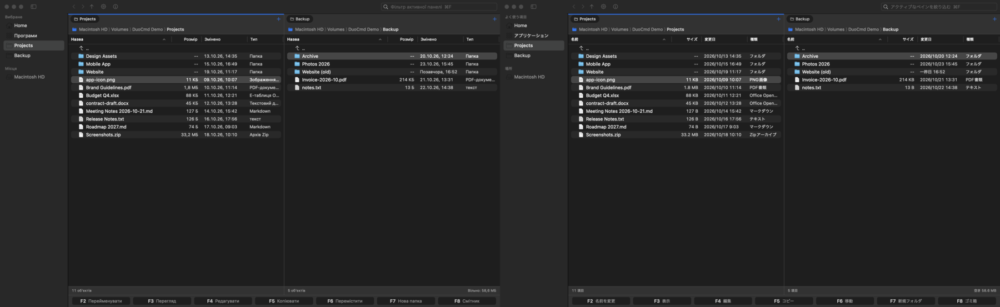

# DuoCmd

**A keyboard-first, dual-pane file manager for macOS, built natively with SwiftUI and AppKit.**

> **DuoCmd FREE Preview — 0.4.0-dev Build 127**
> This is a preview for testing, not a finished product. The app is ad-hoc signed and **not notarized** by Apple; see [Install](#install) for the first launch.



## Why DuoCmd

Commander-style file managers are fast: two folders side by side, every action on the keyboard, F5 to copy and F6 to move. DuoCmd brings that workflow to macOS with a native Mac interface and a careful approach to your files:

- Copies are written under a hidden temporary name, checked, and only then given their final name.
- Nothing is ever deleted permanently: "delete" always means Move to Trash.
- Folders are never merged or replaced.
- System folders and whole disks can't be renamed, moved or trashed.

## Features in this preview

**Panes and navigation**
- Two independent panes, each with tabs (tabs can be locked) and a clickable path bar
- Session restore: tabs, folders and history come back after relaunch
- Go to Folder (⇧⌘G) with completion; editable Favorites in the sidebar
- Filter the active pane as you type (⌘F)
- Mark files by pattern or by the same extension; copy names and paths as text

**Keyboard**
- Function-key bar: F2 Rename, F3 View, F4 Edit, F5 Copy, F6 Move, F7 New Folder, F8 Trash; F9 Open in Terminal
- Two key layouts (Mac conventions or Commander style) and a searchable shortcut editor with conflict checking
- F4 on a folder opens it in the pane; F4 on a file opens it in the editor you choose

**Files**
- Copy, Move, Rename, New Folder and Move to Trash through a journaled operation engine
- When a name already exists: ask each time, keep both, skip, or replace files (the previous version goes to the Trash)
- Paste files from the clipboard (copy or move) and drag-and-drop between panes
- Batch Rename with a live preview (name and extension templates, counter, find and replace, case)
- ZIP: browse an archive, extract all or selected items, create a new ZIP
- Checksums (SHA-256, SHA-1, MD5) with paste-to-compare
- Folder Compare and duplicate finder; both only *mark* files and never remove anything

**Viewing and finding**
- Quick Look, plus a built-in read-only Text/Hex viewer with encodings and Find
- Find Files by walking a folder or with Spotlight, with results shown in a pane
- Inspector and Get Info (⌘I), configurable columns, and on-demand folder sizes

**Look and language**
- Six themes: System, Midnight, Graphite, Arctic, Classic and NEO, plus your own JSON themes
- Adjustable text size (⌘= / ⌘−)
- Ten languages: English, Nederlands, Українська, Deutsch, Français, Español, Italiano, Português, Polski, 日本語, with an in-app language picker

**Works with macOS**
- Open in Terminal (or your preferred terminal app)
- Reveal in Finder, Share, Open With
- No shell commands are ever run for you

| | |
|---|---|
|  |  |
|  |  |
|  |  |
|  |  |

## System requirements

| | |
|---|---|
| macOS | 14.0 (Sonoma) or later |
| Mac | Apple silicon or Intel (Universal app) |
| Tested on | macOS 27.0.1 on Apple silicon (M2) |

macOS 14, 15 and 26, and Intel Macs, are supported by the build settings but **have not yet been tested** on real hardware. Reports from those systems are especially welcome.

## Install

1. Download `DuoCmd-FREE-Preview-0.4.0-dev-b127.dmg` from [Releases](https://github.com/andrii3ol/duocmd/releases).
2. **Verify the download** (recommended). In Terminal, run:
   ```
   shasum -a 256 ~/Downloads/DuoCmd-FREE-Preview-0.4.0-dev-b127.dmg
   ```
   The result must be exactly:
   ```
   9e555b5f3c9f2d33c63ec53abedccaefaee2521c1919918a2f2276042a7e9b77
   ```
3. Open the DMG and drag **DuoCmd** onto **Applications**.
4. **First launch.** DuoCmd isn't notarized yet, so macOS blocks the first launch:
   - **macOS 15 and later:** open DuoCmd, click **Done** in the warning, then go to **System Settings › Privacy & Security**. Scroll to **Security**, click **Open Anyway** next to DuoCmd, confirm, and choose **Open**.
   - **macOS 14:** Control-click DuoCmd in Applications, choose **Open**, then **Open** again.

   You only need to do this once. Please don't disable Gatekeeper or use other workarounds.

**Uninstall:** quit DuoCmd and move it to the Trash. Its settings are in `~/Library/Preferences/com.duocmd.app.dev.plist` and `~/Library/Application Support/DuoCmd`.

## Before you test

- Start with copies of files or a test folder, not your only copy of important data.
- Avoid folders that other apps are changing at the same time (sync tools, editors, builds).
- Crash safety is tested; power-loss safety is not.

See [TESTING.md](TESTING.md) for what to try, [KNOWN_LIMITATIONS.md](KNOWN_LIMITATIONS.md) for what isn't there yet, and [RELEASE_NOTES.md](RELEASE_NOTES.md) for this build.

## Feedback

Please [open an issue](https://github.com/andrii3ol/duocmd/issues/new?template=bug_report.yml) using the bug report form. The most useful details are your macOS version, your Mac (Apple silicon or Intel), the app language, the steps you took, and a screenshot.

## License and terms

**Proprietary freeware preview. © 2026 the DuoCmd author. All rights reserved.**

DuoCmd is free to download and use, but it is not open source. This repository contains documentation and release downloads only. By using a preview build you agree to the [Beta Terms of Use](TERMS.md).
